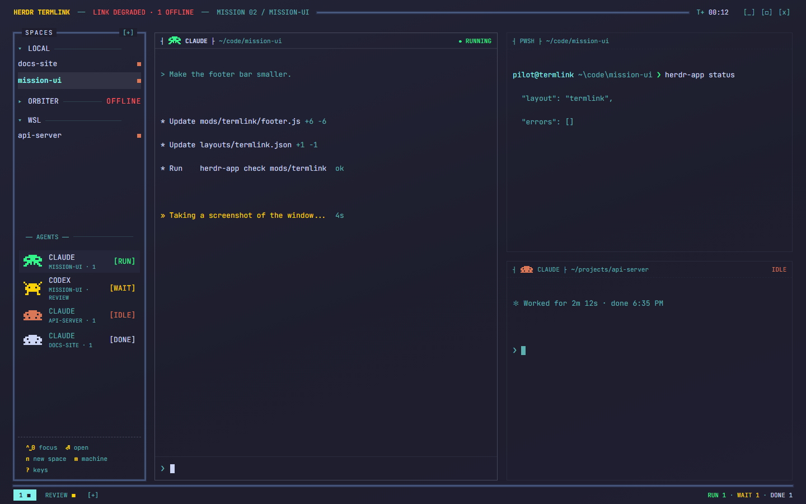

# Termlink

A retro NASA-punk mission-control layout for [Herdr](https://herdr.dev): neon box borders,
a telemetry header, a machines → spaces sidebar with pixel-sprite agents (full, a minimal
64px rail, or hidden), square monospace pane headers and a footer of tab chips with live
agent counts.

## Install

Copy into your Herdr home (`~/.config/herdr-app`):

- `layouts/termlink.json` → `layouts/`
- `themes/termlink.json` → `themes/`
- `mods/termlink/` → `mods/`
- merge `keys.json` into yours (`ctrl-space 0` focus the sidebar, `ctrl-space b` hide/show,
  `ctrl-space shift-b` full ↔ rail); ask before replacing keys you already use.

Then `herdr-app check ~/.config/herdr-app/mods/termlink` and
`herdr-app do layout.switch --name termlink`. `ctrl-shift-l` switches back.

Or ask an agent to add `herdr.dev/layouts/CarlosHPlata/herdr-termlink`.
`RECIPE.md` is the brief to build it from scratch.

The mod runs no programs except `hc machine ls` (to list your machines, only when they
change), reads no files outside its folder and makes no network requests.

MIT licensed.