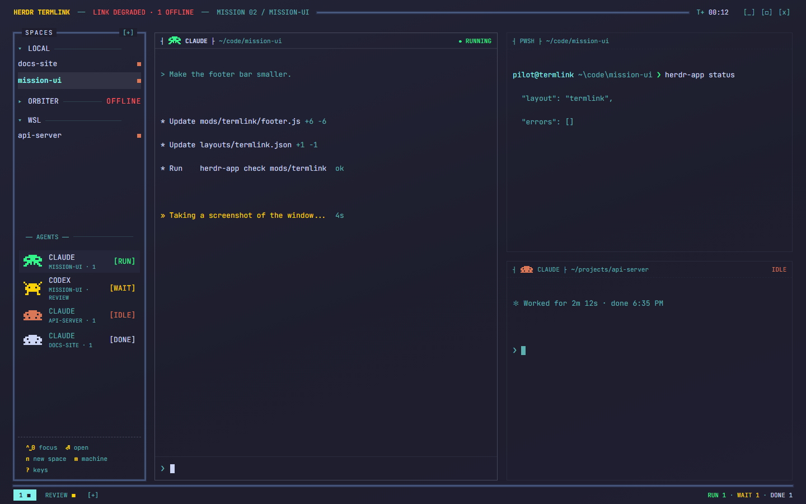

# Termlink

A retro NASA-punk mission-control layout for Herdr: a dark navy window with neon blue
box borders, a yellow `HERDR TERMLINK` telemetry bar, a sidebar of machines → spaces
above pixel-sprite agents, square monospace pane headers (`┤ ▒ CLAUDE ├`), and a footer
of tab chips with live agent counts. Everything is JetBrains Mono and every corner is square.
The sidebar has three states: full, a minimal 64px rail, and hidden.

## What you see

Top to bottom, inside 24px side padding on a `#1e1e2ecc` window (blurred where the system can):

- **Header, 44px** (drags the window). `HERDR TERMLINK` bold `#fbd207` · `──` ·
  `LINK ESTABLISHED` muted `#5bb0b0`, or `LINK DEGRADED · N OFFLINE` in `#ff5a5c` while a
  machine's layout is unavailable · `──` · `MISSION 02 / <SHOWN SPACE>` · a neon line filling
  the rest · `T+ 00:12` (hours:minutes since the layout started, value in `#cdd6f4`) ·
  `[_] [□] [x]` window buttons where the system draws none (Windows, Linux).
- **Body**, a row with 16px gap and 6px vertical padding:
  - **Sidebar, 260px** (resizable 56–420). A box whose border is neon: a 1px `#89b4fa` core
    with fading rings 3px out and in. Legend on the top border: `SPACES` (yellow and bold while the box holds the keyboard);
    `[+]` (new space) on the top border's right.
    - Spaces half: per machine a row `▾ LOCAL ───── ` (11px, muted, uppercase; folds on
      click). On hover a `[+]` appears at its right (new space on that machine); an offline
      machine shows `▸ NAME ──── OFFLINE` in red and opens Settings → Machines on click.
      Under it its spaces, 30px rows, lowercase names indented 28px, a 7px clay `#d97757`
      square at the right when any tab in it runs an agent. The shown space: `#313244`
      background, `#82f2eb` bold text.
    - `── AGENTS ──` rule (28px), the drag handle between the halves.
    - Agents half: 40px rows, a 33×24 pixel sprite (11×8 cells), `CLAUDE` and
      `SPACE · TAB` under it, a `[RUN]` / `[WAIT]` / `[DONE]` / `[IDLE]` tag at the right.
    - Foot: a dashed `#45475a` rule, then key hints `^␣0 focus  ⏎ open  n new space  m machine  ? keys`
      (keys yellow; clicking a hint does the same).
  - **Panes**: the shown tab, 16px gap, square, `#2a2b3d` 1px border (`#45475a` focused),
    transparent background. Each pane has a 28px header: `┤ [sprite] NAME ├` (bold when
    focused), its folder (`~/…`), and its status (`● RUNNING` green, `▲ WAITING` yellow,
    `✓ DONE`, `IDLE`). The focused pane's header has a soft inner glow and a glowing rule
    under it; the others a faint dashed rule.
  - **Panel, 340px** (resizable 260–900, hidden until `ctrl-space o`), at the right with 8px
    vertical padding: a stack of Files and Changes. Both are framed like an unfocused pane:
    square, 1px `#2a2b3d`, transparent background, JetBrains Mono; a 28px header with a
    `┤ FILES ├` / `┤ CHANGES ├` legend in muted `#5bb0b0` (11px) and a dashed `#2a2b3d` rule.
    Rows, badges, the commit field and button are square too (no rounding anywhere).
    Clicking a file in Files opens a new tab named after the file, holding a read-only viewer:
    the code with line numbers and syntax colors, and a 22px status line under it (dashed
    `#2a2b3d` rule above; a `VIEW` chip `#313244`/`#cdd6f4`, the `~/…` path, `N lines`,
    `READ-ONLY`, all 11px `#5bb0b0`). Its pane header reads `┤ FILE.NAME ├`.
- **Footer, 32px**. A neon line on top. The shown space's tabs as chips (shown one: `#82f2eb`
  fill, dark bold text), a small status square on chips whose agents aren't idle, `[+]` new
  tab; at the right `RUN n · WAIT n · DONE n` in their status colors.

Colors (theme `termlink`): background `#1e1e2e`, surfaces `#26263a` / `#313244`, lines
`#89b4fa`, ink `#cdd6f4`, muted `#5bb0b0`, brand `#82f2eb`, yellow `#fbd207`, green
`#32f68a`, red `#ff5a5c`, Claude clay `#d97757`.

### The minimal rail (sidebar small)

64px wide, no legend, no `[+]`, no key hints. Machines are 3-letter tags (`LOC`, `WSL`,
12px, 75% opacity; offline ones red at 50%) with a dimmed `#5bb0b02e` rule above every
machine but the first. Spaces are 44×30 two-letter buttons (`notes-vault` → `NV`, 8px,
`#cdd6f4`), the shown one raised with cyan bold text, a 3px muted dot top-right when an agent
runs inside. A short `──` handle splits it. Agents are still 11×8 sprites (1px cells) at 60%
opacity; the focused and any waiting agent at full. Names show as tooltips.

## How it behaves

- **Agent status**: working: green sprite that walks (two frames, 400 ms) and `[RUN]`;
  blocked: yellow sprite that waves (800 ms) and `[WAIT]`; done: white still sprite, `[DONE]`;
  idle: still sprite in the program's color (clay for Claude), `[IDLE]`. In the rail nothing
  animates.
- **Clicks**: a space selects it; an agent focuses it; a footer chip selects its tab
  (middle-click closes it); machine rows fold; pane-header hover shows `[│] [─] [+] [x]`
  (split right, split down, zoom, close).
- **Split**: spaces and agents share the sidebar 50/50; drag the `── AGENTS ──` rule to
  change it (each half at least 60px), double-click it for 50/50 again. Remembered per copy.
  Each half scrolls on its own; its scrollbar shows only while scrolling.
- **Keys** (`keys.json`):
  - `ctrl-space 0`: the sidebar takes the keyboard (its border and legend turn yellow).
    Then `↑↓` / `j k` move a yellow cursor through the spaces, `⏎` opens one and gives the
    keyboard to its pane, `n` new space, `m` add a machine, `?` help, `esc` back.
  - `ctrl-space b`: hide / show the sidebar. Showing it brings back the size it had.
  - `ctrl-space o`: show / hide the Files/Changes panel; `ctrl-space e` / `ctrl-space g` pick
    Files / Changes inside it (they don't show a hidden panel).
  - `ctrl-space shift-b`: switch between full and the rail (and show it if hidden). The size
    is kept in shared state (`termlink.side.mode`), the full width as last dragged in
    `termlink.side.full`, so both survive restarts.

## Built from

- `layouts/termlink.json`: a column: `header` block (44px, `window_drag`), `body` row
  (`sidebar` block 260px, min 56, max 420; `main` block with `{ "tab": "active" }` and its
  pane frames; `panel` column, hidden, 340px, min 260, max 900, holding the `panel-body`
  stack of `files` (`termlink-files`) and `changes` (`termlink-changes`) blocks), `footer` block (32px). Root: `titlebar: "none"`, `theme: "termlink"`,
  JetBrains Mono for terminals and mods, `window_blur`, `terminal_opacity: 0`, transparent
  `background`/`canvas`/`chrome` colors.
- `themes/termlink.json`: the palette above.
- `mods/termlink/`, one mod in roles (`props.role`): `header`, `side`, `pane` (the tab
  block's pane header, 28px, top), `footer`. `main.js` picks the role; `kit.js` holds the
  palette, the neon `box()` and `neonLine()`, `sprite()` (block characters, animated with
  `.frames()`), `pixels()` (1px divs for the rail), `RAIL_PX`.
- Herdr functions: `spaces`, `agents`, `panes`, `machines`, `run`, `hc(["machine","ls","--json"])`
  (only when `machines()` changes, never on a timer), `openOverlay` (the shipped
  `machine-add` dialog), `shared` / `setShared`, `nextCommand`, `focused`, `settings`,
  `setAgentOrder`, `window()`. Commands: `space.select`, `space.new`, `tab.select`,
  `tab.new`, `tab.close`, `agent.focus`, `pane.split|zoom|close|focus`, `layout.resize`,
  `layout.show`, `app.settings`, `app.help`, `window.minimize|maximize|close`.
- `mods/termlink-files/`, `mods/termlink-changes/`: `mod.clone` of the shipped `files` and
  `changes`, with the outer `.rounded(10)` removed, `.rounded(4|7|8)` → 0, the border
  `#2a2b3d`, `font_family("JetBrains Mono")`, and the 42px header → 28px with the legend and a
  dashed bottom rule. In Files, a file click runs `tab.new {name: <file name>, space, mod:
  "termlink-viewer", props: {file: <root>/<path>, on: <machine>}}` instead of `show()`.
- `mods/termlink-files/editors.js` (`openInEditor(file, on)`): per machine, cached (10 min if yes,
  30 s if no): `sh -c 'command -v nvim'`; Helix: `command -v hx` and a line with `herdr/hx-open` in
  `${XDG_CONFIG_HOME:-~/.config}/helix/config.toml`. Neither: no pane scan at all. Otherwise the
  shown space's terminal panes on that machine (focused, shown tab, other tabs) through
  `hc get --json`, keeping those whose `foreground.cwd` holds the file. Neovim first: the socket
  is named after the `nvim --embed` child, not the TUI pid, so look for `nvim.<pid>.*` sockets of
  the pid and its `pgrep -P` children in `$XDG_RUNTIME_DIR`, `$TMPDIR` (macOS) and `/tmp`, then
  `nvim --server <s> --remote <file>`. Then Helix: write the path to `~/.cache/herdr/hx-open`,
  `hc keys <t> esc f9`. Then `tab.select` and `pane.focus`; false means the viewer tab.
- `mods/termlink-files/keys.js`: `attachKeys` (focus handle, ScrollHandle, the `nextCommand`
  "focus" loop), `onKey` (j/k/h/l, arrows, ⏎, a, c, p, r, esc), `legend`, `isCursor`/`cursorRow`
  (`#26263a` row, `#fbd207` text), `hints` (11px row, dashed `#45475a` rule, keys yellow 600) and
  `ops.create|paste|remove` (PowerShell on local Windows, `sh` elsewhere). `mod.json` gets
  `"focusable": true`. Dialogs: `openOverlay({mod: "termlink-dialog", kind: "dialog", frame: "none"})`;
  the answer comes back in shared `termlink.dialog.result` = `{id, ok, value}`.
- `mods/termlink-dialog/`: props `{id, mode: "prompt" | "confirm", title, detail, yes, no}`; square,
  `#1e1e2e`, 1px `#45475a`, a yellow `┤ TITLE ├` rule; prompt: Enter answers with the text;
  confirm: `y` yes, `n` / Esc no (Enter does nothing, so a delete needs a deliberate key).
- Panel mode: the `files` block's `content.props.mode`, `"pinned"` (default) or `"auto-hide"`.
  termlink-files reads `props().mode`; the header finds the `files` node in `layout()`.
  `ctrl-space o` is `termlink.panel` (header): pinned → `layout.toggle panel`; auto-hide → same
  as `termlink.files`. Auto-hide: the panel's 250 ms focus check runs `layout.hide panel` when the
  keyboard leaves, unless a dialog of its own is open or `window().active` is false.
- `ctrl-space e` is `termlink.files`: the header (always shown) runs `layout.show panel`,
  `layout.select` Files and stamps shared `termlink.files.focus`; termlink-files takes the keyboard
  when it sees a new stamp (or a fresh one at start, if the panel was hidden until then).
- `mods/termlink-viewer/`: props `{file, on}`; `readTextFile` → a readonly `EditorState`
  (same language map and syntax colors as Files) and the status line. `pane.js` names a
  `termlink-viewer` pane after its tab (`spaces()[].tabs[]` by `p.tab`), since a mod pane's
  `panes()` entry carries no props.
- Shipped mods used: `machine-add`.

## Watch out

- `hc keys` can't type `:` (`shift+;` reaches Helix as Shift+semicolon), so drive Helix with a
  binding, not by typing `:open`. `hc send` pastes; it isn't for normal-mode keys.
- herdr-core reports a terminal's foreground program on Unix only; on Windows Helix shows as
  `pwsh`, so the Helix path doesn't apply there yet.
- `hc exec` on the command line splits a `sh -c` script on spaces; a mod's `exec()` doesn't.
  `hc file` paths don't expand `~`.
- A mod copy starts only once it's shown: test a mod in a shown tab, not `focus: false`.
- Fields you add to the cloned Files view must not reuse its own names: it already has
  `this.pending` (a Set of loading folders, reset on every context change), so the dialog state is
  `tlDialog`. Reusing `pending` left auto-hide stuck after the first viewer tab.
- Testing auto-hide from a shell: the Herdr window isn't the active OS window then, so the
  `window().active` guard keeps the panel; that guard is what stops alt-tab from hiding it.
- `FocusHandle.focus()` throws during render, and a task `cx.spawn`ed from `render()` starts inside
  it: react to shared state from render with `cx.timer.after(1, …)`, not `cx.spawn`.
- Write a new mod's `mod.json` (`"place": "none"`) before its `main.js`: if Herdr sees the
  folder first it docks a copy by wrapping the layout root in a new row, and root-only fields
  (`titlebar`, `window_blur`, theme) stop applying.
- Don't edit the shipped `files` / `changes`: Herdr restores them on every start (and moves
  your edit to `<name>-edited`). Clone them and point the layout at the clones.
- The cloned mods' sources use CRLF line endings on Windows; match patterns accordingly.
- Every copy of a mod gets every `<mod>.<command>`; each role ignores what isn't its own.
  A hidden sidebar gets none, so the header (always shown) handles `side_size`.
- `FocusHandle.focus()` can't run during render: focus from the `nextCommand()` task.
- `on_size_change` reports zoomed pixels; layout sizes are at zoom 1. Divide by
  `settings().zoom` before storing the full width, or it grows by the zoom on every switch.
- Rows that fill the box must stay inside its border's rings (about 6px): the body is inset
  7px, or a highlighted row covers the neon edge.
- The clock redraws once a minute, and only while the window is focused. Don't animate with
  timers; sprites use `.frames()`.
- The sidebar's `min` must be ≤ 64 for the rail; the full sidebar can then be dragged that
  narrow too.
- Spaces' agent squares come from `panes()` (any pane of any tab with an agent program or a
  status), not `agents()`, so a space with an idle shell-started agent still shows one.

## Done when

- `ctrl-space e` from a terminal shows Files with a yellow legend, a yellow cursor row and the key
  row; `j`/`k` move it, `⏎` on a file opens it and the keyboard goes there, `esc` goes back.
- With `"mode": "auto-hide"`: `ctrl-space e` shows Files focused, `esc` hides it and the panes
  widen; `ctrl-space o` does the same as `e`. With `"pinned"` the panel stays after `esc`.
- `a` then `x/y.txt` ⏎ creates `x/y.txt`; `c`, `p` on it makes `y copy.txt`; `r`, `y` deletes it.

- `ctrl-space o` shows a square Files panel at the right with a `┤ FILES ├` header the same
  height as the pane headers; `ctrl-space g` shows Changes with the same frame.
- With Neovim running in a WSL space's folder, and Helix too in an earlier tab, a click opens the
  file in Neovim (its status line names it) in about 200 ms and leaves Helix alone.
- With the F9 binding in WSL's Helix config and `hx` running in a WSL space's folder, clicking a
  file of that folder in Files shows that Helix with the file open (status line names it) in
  about 300 ms; with the binding removed, the same click opens the viewer tab.
- Clicking `keys.json` in Files opens a `KEYS.JSON` tab with the highlighted file and
  `VIEW ~/…/keys.json  N lines  READ-ONLY` under it; the panel keeps showing the tree.

- `herdr-app check mods/termlink` passes and `layout.switch {name: "termlink"}` shows the
  header, sidebar box, panes and footer as above, with no `layout.error`.
- With another machine added and offline, the header reads `LINK DEGRADED · 1 OFFLINE` and
  the sidebar lists it as `OFFLINE`; clicking it opens Settings → Machines.
- A running Claude shows a walking green sprite and `[RUN]` in the sidebar, `● RUNNING` in
  its pane header, and `RUN 1` in the footer.
- `ctrl-space shift-b` turns the sidebar into the 64px rail; `ctrl-space b` twice hides and
  shows it still as the rail; `ctrl-space shift-b` brings back the full sidebar at its
  previous width.
- `ctrl-space 0` (or clicking `^␣0 focus`) turns the sidebar border yellow; `↓` then `⏎` opens the next space.
- Dragging `── AGENTS ──` changes the split, and it is the same after reloading the mod.
